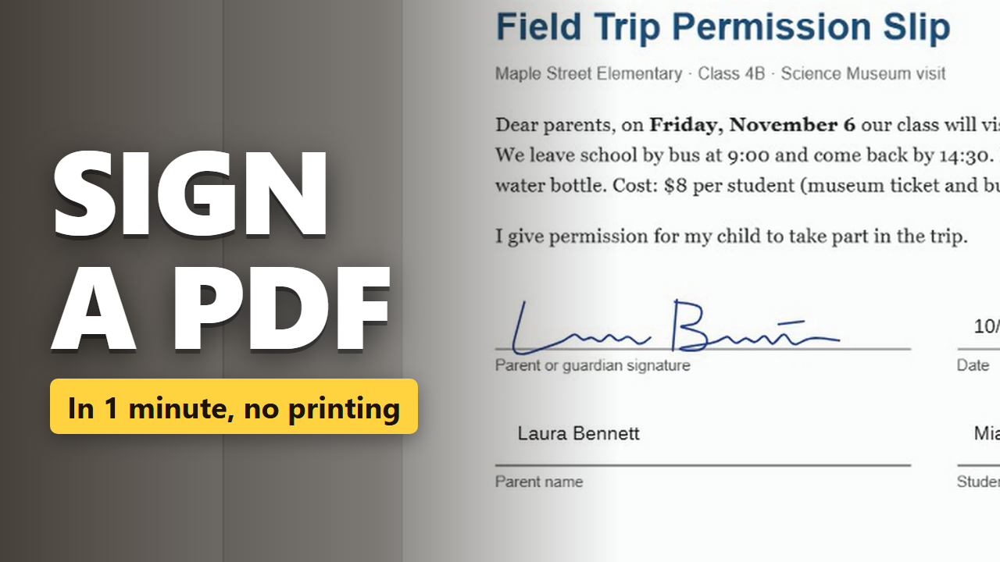

# pdf-signing-helpers

Two small Node.js scripts for the paperwork around signing a PDF. No dependencies, Node 18+.

- `make-sign-form.js` builds a blank one-page form with lines for a name, a date and a signature. Handy for trying out a signing app, a stylus or a printer before you touch the real document.
- `signing-receipt.js` compares the original PDF with the signed copy and writes a JSON receipt: SHA-256 fingerprints, sizes, page counts and the time. Keep it next to the files and you can always tell which version you signed and sent back.

## Usage

```bash
node scripts/make-sign-form.js form.pdf --title "Field trip permission"   # Letter size
node scripts/make-sign-form.js form.pdf --a4                              # A4
node scripts/signing-receipt.js "Field trip permission.pdf" "Field trip permission-signed.pdf" receipt.json
npm test
```

Example receipt (shortened):

```json
{
  "created": "2026-10-22T09:12:40.512Z",
  "original": { "file": "Field trip permission.pdf", "bytes": 67355, "pages": 1, "revisions": 1,
                "sha256": "bf8316c820827fbe65793ca28e9748a229954aba78f634968e07297914feded5" },
  "signed": { "file": "Field trip permission-signed.pdf", "bytes": 71250, "pages": 1, "revisions": 1,
              "sha256": "4014efd19d588285f94d76b224d1f621fd652dab5c1c2863f1c73a09eb988cf4" },
  "warnings": []
}
```

`revisions` counts how many times the file was saved by appending to it. The script exits with code 2 and fills `warnings` when the signed copy is byte for byte the same as the original (nothing was signed) or has a different number of pages.

## Signing the PDF itself

The scripts do not sign anything, they cover the steps before and after. For the signing step we use a browser signer where you write on the page with the mouse or a finger, type a name, drop in today's date and save a `-signed` copy. The file stays on your device. The receipt example above was made from a form signed this way.

**Try it here: [toolster.net/sign_pdf](https://toolster.net/sign_pdf)** (also in [Russian](https://ru.toolster.net/sign_pdf) and [Spanish](https://es.toolster.net/sign_pdf)).



## License

MIT for the scripts in this repository. The signer is a separate hosted app and its code is not part of this repo.
